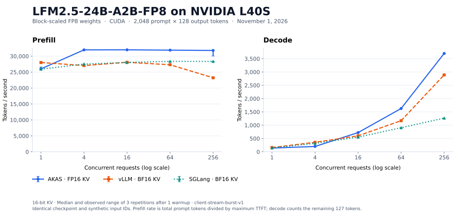
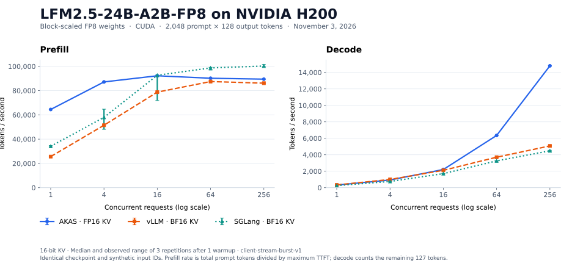
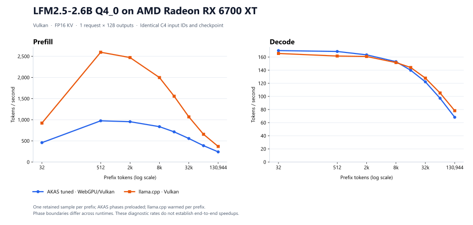
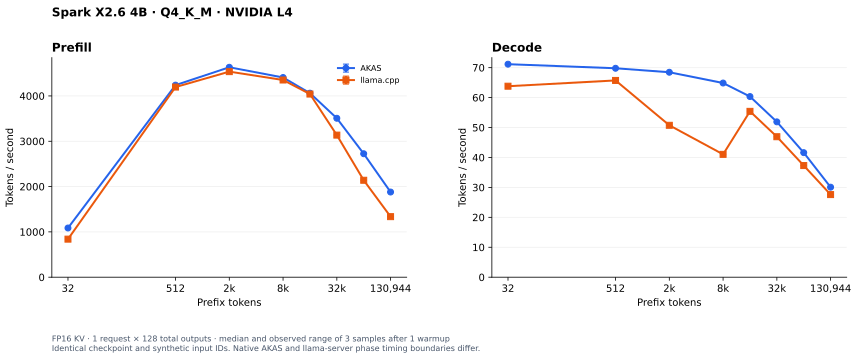
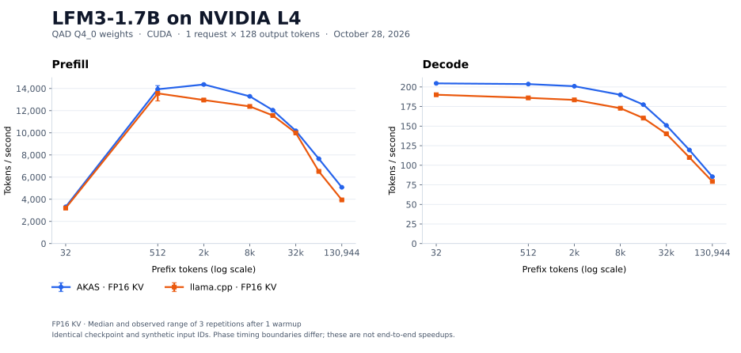
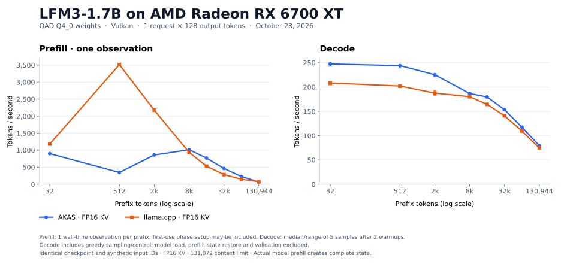

<p align="center">
  
  
</p>

<h1 align="center">Compiler-first model inference.</h1>

<p align="center">
  Compose models in pure Python, fuse a whole model at compile time. <br> 
  Serve AOT-compiled .tbin programs without PyTorch or TileLang at runtime.
</p>

---

AKAS is an inference engine built on [Tensor](https://github.com/kreasof-ai/tensor).
It owns model definitions, checkpoint loading, request scheduling, persistent state,
generation and serving. Tensor provides compilation and device execution.

## Benchmark showcase

**LFM2.5-24B-A2B-FP8 · Block-scaled FP8 weights · NVIDIA L40S (46,068 MiB) · CUDA**

Results from the [November 1, 2026 comparison](https://github.com/kreasof-ai/akas/blob/f19575adf59fa682eb15ac3756de0f62a8320728/benchmarks/reports/20261101T074055Z-ad51ac551826/COMPARISON.md),
across concurrent batch sizes 1 through 256 with 2,048 prompt tokens and 128 total
output tokens per request. All runtimes use identical official checkpoint bytes,
deterministic synthetic prompt IDs, pure autoregressive decoding and 16-bit KV
(AKAS FP16 KV; vLLM 0.31.0 and SGLang 0.5.21 BF16 KV). Rates are medians of three
retained repetitions after one warmup.



<details>
<summary>Measurements (tokens per second) and median TTFT</summary>

| Concurrent requests | AKAS prefill tok/s | vLLM prefill tok/s | SGLang prefill tok/s | AKAS decode tok/s | vLLM decode tok/s | SGLang decode tok/s | AKAS TTFT ms | vLLM TTFT ms | SGLang TTFT ms |
| ---: | ---: | ---: | ---: | ---: | ---: | ---: | ---: | ---: | ---: |
| 1 | 26,018.8 | 28,016.3 | 25,915.5 | 140.2 | 159.7 | 146.7 | 78.7 | 73.1 | 79.0 |
| 4 | 31,975.3 | 27,059.3 | 27,521.3 | 201.2 | 357.0 | 316.6 | 256.2 | 302.7 | 297.7 |
| 16 | 31,990.3 | 28,078.3 | 28,033.2 | 722.5 | 600.2 | 550.6 | 1,024.3 | 1,167.0 | 1,168.9 |
| 64 | 31,888.5 | 27,312.1 | 28,369.9 | 1,627.9 | 1,169.9 | 905.4 | 4,110.3 | 4,799.0 | 4,620.1 |
| 256 | 31,797.5 | 23,224.5 | 28,358.3 | 3,698.0 | 2,890.9 | 1,266.4 | 16,488.4 | 22,574.7 | 18,488.0 |

</details>

AKAS prefill medians exceed both vLLM and SGLang at **B=4 through B=256** (by
**12.1–16.2%** over the faster baseline), with lower median TTFT at **4/5 batch
sizes**. Decode medians exceed both baselines at **B=16 (+20.4%), B=64 (+39.1%)
and B=256 (+27.9%)**, while trailing at B=1 and B=4.

All three runtimes are measured through `client-stream-burst-v1`: TTFT includes
queueing and token delivery, prefill rate is total prompt tokens divided by maximum
TTFT, and decode counts the remaining 127 output tokens after the first prediction.
Model loading and compilation are excluded. Three-way numerical qualification
matches **16/16** greedy first tokens across BOS-prefixed and chat-template probes
with matching FP8 Tensor Core logit noise floor across all three engines. See the
[campaign report](https://github.com/kreasof-ai/akas/blob/f19575adf59fa682eb15ac3756de0f62a8320728/benchmarks/reports/20261101T074055Z-ad51ac551826/README.md)
and [three-way numerical qualification](https://github.com/kreasof-ai/akas/blob/8ce8c3da31b2c74f0cd757be3bf152b2e25bc239/benchmarks/runs/20261101113717922004-dcb7262b/report.json)
for raw samples, selected kernel schedules and logit comparisons.

Regenerate the plot with `uv run python tools/plot_comparison.py`.

**LFM2.5-24B-A2B-FP8 · Block-scaled FP8 weights · NVIDIA H200 (143,771 MiB) · CUDA**

Results from the [November 3, 2026 comparison](https://github.com/kreasof-ai/akas/blob/2e8d1df4513b30ad7806606e0f47b09d8e5485f7/benchmarks/reports/20261103T091207Z-e3686524dce5/COMPARISON.md),
across concurrent batch sizes 1 through 256 with 2,048 prompt tokens and 128 total
output tokens per request. All runtimes use identical official checkpoint bytes,
deterministic synthetic prompt IDs, pure autoregressive decoding and 16-bit KV
(AKAS FP16 KV; vLLM 0.31.0 and SGLang 0.5.21 BF16 KV).



<details>
<summary>Measurements (tokens per second) and median TTFT</summary>

| Concurrent requests | AKAS prefill tok/s | vLLM prefill tok/s | SGLang prefill tok/s | AKAS decode tok/s | vLLM decode tok/s | SGLang decode tok/s | AKAS TTFT ms | vLLM TTFT ms | SGLang TTFT ms |
| ---: | ---: | ---: | ---: | ---: | ---: | ---: | ---: | ---: | ---: |
| 1 | 64,458.8 | 25,618.1 | 34,099.5 | 319.3 | 333.8 | 250.8 | 31.8 | 79.9 | 60.1 |
| 4 | 87,152.9 | 51,464.2 | 57,952.2 | 932.5 | 998.5 | 755.5 | 94.0 | 159.2 | 141.4 |
| 16 | 92,201.5 | 78,728.2 | 92,650.8 | 2,207.9 | 2,107.2 | 1,705.6 | 355.4 | 416.2 | 353.7 |
| 64 | 90,179.5 | 87,455.9 | 98,686.5 | 6,343.1 | 3,699.2 | 3,253.0 | 1,453.5 | 1,498.7 | 1,328.2 |
| 256 | 89,432.5 | 86,126.2 | 100,233.6 | 14,799.1 | 5,071.3 | 4,479.9 | 5,862.4 | 6,087.4 | 5,230.7 |

</details>

AKAS prefill rates exceed vLLM at **5/5 batch sizes** (up to **2.52x** at B=1 and
**+17.1%** at B=16) and exceed SGLang at **B=1 (+89.0%) and B=4 (+50.4%)**, reaching
**92,201.5 tok/s** at B=16. Decode rates exceed SGLang at **5/5 batch sizes** and
exceed both baselines at **B=16 (+4.8%, 49.7% MBU), B=64 (+71.5%, 56.1% MBU) and
B=256 (+191.8%, 14,799.1 tok/s, 43.1% MBU)**. See the
[campaign report](https://github.com/kreasof-ai/akas/blob/2e8d1df4513b30ad7806606e0f47b09d8e5485f7/benchmarks/reports/20261103T091207Z-e3686524dce5/README.md)
and [selected schedules](https://github.com/kreasof-ai/akas/blob/2e8d1df4513b30ad7806606e0f47b09d8e5485f7/benchmarks/reports/20261103T091207Z-e3686524dce5/SCHEDULES.json)
for full provenance, MFU/MBU estimates and kernel configurations.

Regenerate the plot after retrieving the archived report:

```sh
python -m tools.benchmark_archive fetch reports 20261103T091207Z-e3686524dce5
uv run python -m tools.plot_comparison REPORT_DIRECTORY/report.json build/throughput-h200.svg
```

**LFM2.5-2.6B · Q4_0 weights · AMD Radeon RX 6700 XT (12 GB) · Vulkan**

Results from the [October 25, 2026 comparison](https://github.com/kreasof-ai/akas/blob/1313601fac2716250811b46f727493a64df4b82d/benchmarks/reports/20261024T191042Z-60f28059ed28/COMPARISON.md),
with one request generating 128 tokens. All rates are tokens per second;
both runtimes use FP16 KV.



<details>
<summary>Measurements (tokens per second)</summary>

| Mode | Phase | Prefix tokens | AKAS FP16 KV | llama.cpp FP16 KV |
| --- | --- | ---: | ---: | ---: |
| Autoregressive | Prefill | 32 | 458.0 | 921.0 |
| Autoregressive | Prefill | 512 | 974.8 | 2,596.5 |
| Autoregressive | Prefill | 2,048 | 953.1 | 2,470.2 |
| Autoregressive | Prefill | 8,192 | 835.6 | 1,997.9 |
| Autoregressive | Prefill | 16,384 | 712.8 | 1,556.3 |
| Autoregressive | Prefill | 32,768 | 556.0 | 1,068.5 |
| Autoregressive | Prefill | 65,536 | 386.2 | 655.5 |
| Autoregressive | Prefill | 130,944 | 239.5 | 367.6 |
| Autoregressive | Decode | 32 | 169.8 | 165.4 |
| Autoregressive | Decode | 512 | 168.5 | 161.5 |
| Autoregressive | Decode | 2,048 | 163.3 | 160.8 |
| Autoregressive | Decode | 8,192 | 152.9 | 151.5 |
| Autoregressive | Decode | 16,384 | 139.8 | 144.0 |
| Autoregressive | Decode | 32,768 | 122.2 | 127.9 |
| Autoregressive | Decode | 65,536 | 97.1 | 105.2 |
| Autoregressive | Decode | 130,944 | 68.2 | 78.2 |

</details>

These are reported phase rates with one retained sample per prefix. AKAS preloads
its phases; llama.cpp has one warmup per prefix. Timing boundaries differ, and
complete-burst throughput was not measured for AKAS. See the
[tuning report](https://github.com/kreasof-ai/akas/blob/1313601fac2716250811b46f727493a64df4b82d/benchmarks/reports/20261024T191042Z-60f28059ed28/TUNING.md)
for mixed-precision prefill, FP32 decode arithmetic, qualification and output
agreement, and the [replay instructions](https://github.com/kreasof-ai/akas/blob/2a5fff2394e5822373e18fdb9f072c9d204169e8/benchmarks/runs/20261025123404575934-98dca4dc/REPRODUCE.md)
for retained programs and plotting commands.

Regenerate the plot after retrieving the archived report:

```sh
python -m tools.benchmark_archive fetch reports 20261024T191042Z-60f28059ed28
uv run python -m tools.vulkan_plot REPORT_DIRECTORY/report.json build/throughput.png
```

Replace `REPORT_DIRECTORY` with the verified directory printed by the fetch command.

**Spark X2.6-4B · Q4_K_M weights · NVIDIA L4 (23,034 MiB) · CUDA**

Results from the [October 26, 2026 compact packed-weight comparison](https://github.com/kreasof-ai/akas/blob/409fb009fc0429da6e6a67576c446cfe55487724/benchmarks/reports/20261026T141034Z-d68a20ede35c/README.md).
Both runtimes were measured with one request generating 128 total output tokens,
identical official checkpoint bytes, synthetic prompt IDs and FP16 KV. Rates
are medians of three retained repetitions after one warmup. Quantized weights
stay packed; no persistent FP16 weight copy is allocated.



<details>
<summary>Measurements (tokens per second) and estimated prefill MFU</summary>

| Prefix tokens | AKAS prefill tok/s | llama.cpp prefill tok/s | AKAS decode tok/s | llama.cpp decode tok/s | Estimated AKAS prefill MFU |
| ---: | ---: | ---: | ---: | ---: | ---: |
| 32 | 1,085.6 | 839.9 | 71.2 | 63.8 | 6.80% |
| 512 | 4,238.4 | 4,195.7 | 69.8 | 65.7 | 26.99% |
| 2,048 | 4,632.6 | 4,536.1 | 68.5 | 50.7 | 30.25% |
| 8,192 | 4,406.6 | 4,351.3 | 64.9 | 41.0 | 30.50% |
| 16,384 | 4,061.0 | 4,041.3 | 60.3 | 55.4 | 30.15% |
| 32,768 | 3,507.1 | 3,135.5 | 51.9 | 46.9 | 29.55% |
| 65,536 | 2,724.4 | 2,139.1 | 41.6 | 37.3 | 28.39% |
| 130,944 | 1,879.4 | 1,336.2 | 30.1 | 27.6 | 27.08% |

</details>

Peak GPU memory was **7.71 GiB for AKAS and 7.73 GiB for llama.cpp**
with the full 131072-token context reservation. Both keep the input embedding
on the CPU; AKAS maps 640 MiB of pinned host memory. All transformer weights
and the output head remain on the GPU. The earlier packed-weight AKAS run
peaked at 9.50 GiB. Shared allocations and scratch, compact rotary tables,
fused prefill, compact sliding rings and FP16 activation staging reduce memory and prefill traffic.

Prefill medians meet or exceed llama.cpp at 8/8 prefixes. Decode medians
exceed it at 8/8, with all retained decode samples ahead at 8/8.
These observations describe this measured configuration. AKAS uses a maximum
2048-token prefill chunk and llama.cpp uses 512. Native synchronized AKAS
phases and llama-server eval phases have different timing boundaries; loading
is excluded. The sealed llama.cpp run from earlier in this session is reused
with its pinned binary and matching workload unchanged. Estimated MFU counts
useful model math against L4’s 121 TFLOP/s
dense FP16 peak and is not a hardware instruction counter.

[Spark model support and usage](src/akas/models/spark/README.md) also cover BF16
safetensors and native FP8 weights with channel scales. See the
[memory assessment, MFU method and GPU telemetry](https://github.com/kreasof-ai/akas/blob/6243760e7784bcf2e62fe4819696ed64c3d0f62d/benchmarks/runs/20261026155042227779-0a568a08/analysis/README.md)
and [full report](https://github.com/kreasof-ai/akas/blob/409fb009fc0429da6e6a67576c446cfe55487724/benchmarks/reports/20261026T141034Z-d68a20ede35c/README.md) for raw samples, output comparisons and selected
schedules. Earlier results remain immutable in [the archive catalog](benchmarks/archive.json).

**LFM3-1.7B · QAD Q4_0 weights · NVIDIA L4 (23,034 MiB) · CUDA**

Results from the [October 28, 2026 comparison](https://github.com/kreasof-ai/akas/blob/2f19a43426682bc9dbeff464b988b2544cec000c/benchmarks/reports/20261027T185932Z-b917d23ac845/COMPARISON.md),
with one request generating 128 total output tokens. Both runtimes use identical
official checkpoint bytes, deterministic synthetic prompt IDs and FP16 KV.
Rates are medians of three retained repetitions after one warmup.



<details>
<summary>Measurements (tokens per second)</summary>

| Prefix tokens | AKAS prefill tok/s | llama.cpp prefill tok/s | AKAS decode tok/s | llama.cpp decode tok/s |
| ---: | ---: | ---: | ---: | ---: |
| 32 | 3,315.6 | 3,206.4 | 204.6 | 190.1 |
| 512 | 13,932.3 | 13,559.7 | 203.7 | 186.1 |
| 2,048 | 14,363.0 | 12,957.2 | 200.9 | 183.5 |
| 8,192 | 13,293.5 | 12,381.4 | 190.0 | 172.8 |
| 16,384 | 12,041.7 | 11,565.9 | 177.4 | 160.3 |
| 32,768 | 10,176.7 | 9,988.2 | 150.9 | 140.2 |
| 65,536 | 7,655.9 | 6,517.1 | 119.5 | 110.0 |
| 130,944 | 5,081.0 | 3,942.3 | 85.4 | 79.3 |

</details>

Prefill and decode medians exceed llama.cpp at **8/8 prefixes**. The measured
improvement is **1.9–28.9% for prefill** and **7.6–10.7% for decode**. Weights
retain one packed device copy. Large Q4 prefill projections use block-32 Q8
activations with FP32 scaling and accumulation; decode uses floating activations.

AKAS uses a maximum 1024-token prefill chunk and llama.cpp uses 512. Native
synchronized AKAS phases and llama-server eval phases have different timing
boundaries; loading is excluded. The pinned llama.cpp run is reused unchanged.
Generated sequences differ at some prefixes. See the [full report](https://github.com/kreasof-ai/akas/blob/2f19a43426682bc9dbeff464b988b2544cec000c/benchmarks/reports/20261027T185932Z-b917d23ac845/README.md)
for raw samples, output comparisons and selected schedules, and the
[validation and reproduction notes](https://github.com/kreasof-ai/akas/blob/c1d260dc031cc412ab59180286c5dda978f6cee3/benchmarks/runs/20261028073053545412-431db636/analysis/VALIDATION.md) for numerical checks and the
retained compilation recipe. [LFM3 support and usage](src/akas/models/lfm3/README.md)
also cover BF16 and block-scaled FP8 safetensors.

Regenerate the plot with `python -m tools.lfm3_plot REPORT_JSON OUTPUT_SVG`
after retrieving the archived report.

**LFM3-1.7B · QAD Q4_0 weights · AMD Radeon RX 6700 XT (12 GB) · Vulkan**

Results from the [October 28, 2026 comparison](https://github.com/kreasof-ai/akas/blob/655e658aa7cb1adca295d54adde56076f59e6e71/benchmarks/reports/20261028T123406Z-5a82c9f7e263/README.md),
with one request generating 128 total output tokens and a 131,072-token context
reservation. Both runtimes use identical official checkpoint bytes, deterministic
synthetic prompt IDs and FP16 KV. Decode rates are medians of five repetitions
after two warmups; 127 decode steps are timed after the first prediction. Prefill
rates are one completed-wall observation per prefix and can include first-use
phase setup.



<details>
<summary>Prefill observations and decode medians (tokens per second)</summary>

| Prefix tokens | AKAS prefill tok/s | llama.cpp prefill tok/s | AKAS decode tok/s | llama.cpp decode tok/s |
| ---: | ---: | ---: | ---: | ---: |
| 32 | 899.0 | 1,182.3 | 247.5 | 208.2 |
| 512 | 344.8 | 3,514.8 | 244.1 | 202.1 |
| 2,048 | 859.0 | 2,176.9 | 225.4 | 187.5 |
| 8,192 | 1,014.5 | 935.6 | 186.6 | 180.1 |
| 16,384 | 767.5 | 529.2 | 179.6 | 164.4 |
| 32,768 | 462.5 | 282.7 | 153.4 | 140.9 |
| 65,536 | 226.5 | 146.3 | 117.3 | 109.6 |
| 130,944 | 64.0 | 74.0 | 79.5 | 74.6 |

</details>

Decode medians exceed llama.cpp at **8/8 prefixes**, by **3.6–20.8%**. The
full-context case reaches **79.55 tok/s versus 74.63 tok/s (+6.59%)**. Shared KV
reads across GQA heads and a hierarchical attention merge improve long decode;
weights remain packed and decode activations, scores and accumulation are FP32.
The recorded programs use mixed prefill arithmetic and explicit FP16 KV rounding.

Both timers cover completed wall decode including greedy sampling and control
dispatch. AKAS uses GPU token feedback; llama.cpp b11946 Vulkan C API uses its
stock greedy sampler. Each sample restores complete state produced by actual
model prefill and its first prediction; load, prefill, state restoration and
validation are excluded. Prefill observations are single samples in the raw
records and do not establish prefill or end-to-end latency parity. Prefixes through
8,192 use the 32-partition program; longer prefixes use the 512-partition program.

Generated sequences differ at some prefixes. Independent GPU model qualification
passes its existing numerical bounds and greedy-token checks; a separate natural
language demonstration matches 88/88 tokens. See the [full report](https://github.com/kreasof-ai/akas/blob/655e658aa7cb1adca295d54adde56076f59e6e71/benchmarks/reports/20261028T123406Z-5a82c9f7e263/README.md)
for samples, output comparisons and selected schedules, and the
[reproduction and validation assets](https://github.com/kreasof-ai/akas/blob/0eb5d7bd19581ec85803285505cf521819170d38/benchmarks/runs/20261028151859229290-78dfc7e2/reproduction/README.md) for pinned runtime
identities, compilation settings and the text demonstration.

Regenerate the plot after retrieving the archived report:

```sh
python -m tools.benchmark_archive fetch reports 20261028T123406Z-5a82c9f7e263
python -m tools.lfm3_vulkan_plot REPORT_DIRECTORY/report.json build/throughput.svg
```

Replace `REPORT_DIRECTORY` with the verified directory printed by the fetch command.

## Getting started

Use Python 3.12. `uv.lock` pins Tensor to a published Git revision.

```sh
uv sync --locked --extra compiler --extra serving
uv run --no-sync python tools/bootstrap_nvrtc.py --out build/nvrtc-12.9
export TENSOR_NVRTC_HOME="$PWD/build/nvrtc-12.9"
```

The compiler is needed to build programs. Precompiled programs run without compiler
packages. Optional extras are `webgpu`, `serving`, `reference`, and `cloud`.

Optimize a serving deployment by giving the checkpoint, workload and time budget.
AKAS detects the model/backend and chooses inference settings:

```sh
akas optimize --model /path/to/model.gguf --workload standard-v1 \
  --budget 30m --out build/deployment
akas serve --deployment build/deployment/deployment.json
```

Install the `serving` extra for this workflow. See the
[optimization guide](docs/optimization.md) for resource constraints, measurements
and resuming a search. To control compilation directly, use the model definition
and shared compiler. Kernel beam search runs by default:

```sh
akas compile --definition akas.models.lfm2.model:LFM2 \
  --checkpoint /path/to/model.gguf --out build/model \
  --config '{"geometries":[[1,1],[1,128]],"max_requests":1,"max_context":4096,"provider":"cuda","target":"sm_89"}'
akas generate --definition akas.models.lfm2.model:LFM2 \
  --model /path/to/model.gguf --bundle build/model --prompt Hello --max-tokens 32
```

Supported checkpoint formats and operation implementations depend on the model
and provider. See the [model declarations](src/akas/models/README.md).

Use `akas bench` for repeated prompt/decode measurements across batch sizes and
context lengths. `akas bench --help` lists compilation, timing, baseline comparison
and scaling regression options. `akas serve --factory module:callable` runs the
shared HTTP server with a caller-supplied service factory.

The package layout is documented beside the implementation:

- [Models](src/akas/models/README.md): architecture, checkpoint mapping and composition.
- [Quantization](src/akas/quantization/README.md): format-owned storage, codecs and kernels.
- [Operations](src/akas/ops/README.md): shared TileLang kernels, backend decisions and a beginner authoring guide.
- [Compilation](src/akas/compilation/README.md): graph composition, optimization, program building and default tuning.
- [Optimization](src/akas/optimization/README.md): autonomous compilation, serving measurement and deployment selection.
- [Benchmarking](src/akas/benchmarking/README.md): measurements, reproducible run history and schedule reuse.
- [Execution](src/akas/execution/README.md): shared request state and phase execution.

[The complete bigram model](examples/models/bigram/) demonstrates the uniform
model declaration and request lifecycle. [The residual graph](examples/graphs/residual/)
demonstrates standalone numerical composition using existing operations. `tests/support` contains synthetic checkpoints and
independent numerical oracles used by core tests.

```sh
uv run --no-sync python -m pytest
uv build
```

Read the [guides](docs/README.md) to extend the engine.
[Benchmark history](benchmarks/README.md) records measurements by source, hardware,
workload and configuration, with qualified schedules available for later searches.
