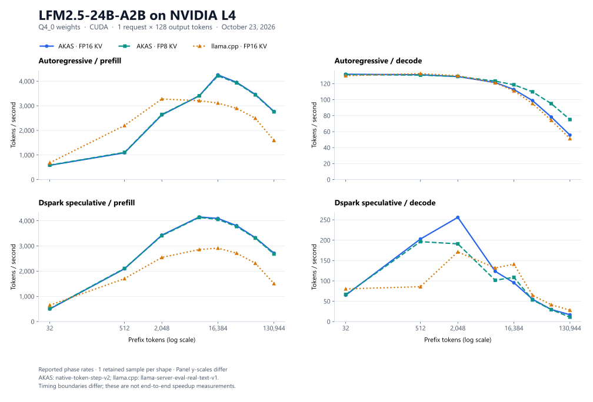

# AKAS

AKAS is an inference engine built on [Tensor](https://github.com/kreasof-ai/tensor).
It owns model definitions, checkpoint loading, request scheduling, persistent state,
generation and serving. Tensor provides compilation and device execution.

## Benchmark showcase

**LFM2.5-24B-A2B · Q4_0 weights · NVIDIA L4 (23,034 MiB) · CUDA**

Selected results from the [October 23, 2026 comparison](benchmarks/reports/20261023T155400Z-cdcde64a14b5/COMPARISON.md),
with one request generating 128 tokens. All rates are tokens per second; FP16 and
FP8 below refer to the KV cache dtype.



<details>
<summary>Selected measurements (tokens per second)</summary>

| Mode | Phase | Prefix tokens | AKAS FP16 KV | AKAS FP8 KV | llama.cpp FP16 KV |
| --- | --- | ---: | ---: | ---: | ---: |
| Autoregressive | Prefill | 2,048 | 2,631.2 | 2,648.7 | 3,279.2 |
| Autoregressive | Prefill | 16,384 | 4,259.0 | 4,220.0 | 3,112.6 |
| Autoregressive | Prefill | 130,944 | 2,771.7 | 2,755.7 | 1,593.4 |
| Autoregressive | Decode | 2,048 | 128.9 | 129.0 | 129.9 |
| Autoregressive | Decode | 16,384 | 112.7 | 118.6 | 111.0 |
| Autoregressive | Decode | 130,944 | 55.7 | 75.1 | 51.3 |
| Dspark speculative | Prefill | 2,048 | 3,430.9 | 3,409.4 | 2,544.8 |
| Dspark speculative | Decode | 2,048 | 256.1 | 191.0 | 171.2 |

</details>

These are reported phase rates from a diagnostic context sweep with one retained
sample per shape. AKAS uses `native-token-step-v2`; llama.cpp uses
`llama-server-eval-real-text-v1`. Their timing boundaries differ, so these values
do not establish equivalent kernel timings or end-to-end speedups. Complete-burst
throughput was not measured. Speculative performance varies with context and draft
acceptance; the [full comparison](benchmarks/reports/20261023T155400Z-cdcde64a14b5/COMPARISON.md)
includes shorter and longer contexts, including speculative slowdowns. See the
[campaign report](benchmarks/reports/20261023T155400Z-cdcde64a14b5/README.md)
for hardware, retained settings, qualification and output agreement.

Regenerate the plot with `uv run python tools/plot_comparison.py`.

## Getting started

Use Python 3.12. `uv.lock` pins Tensor to a published Git revision.

```sh
uv sync --locked --extra compiler --extra serving
uv run --no-sync python tools/bootstrap_nvrtc.py --out build/nvrtc-12.9
export TENSOR_NVRTC_HOME="$PWD/build/nvrtc-12.9"
```

The compiler is needed to build programs. Precompiled programs run without compiler
packages. Optional extras are `webgpu`, `serving`, `reference`, and `cloud`.

Optimize a serving deployment by giving the checkpoint, workload and time budget.
AKAS detects the model/backend and chooses inference settings:

```sh
akas optimize --model /path/to/model.gguf --workload standard-v1 \
  --budget 30m --out build/deployment
akas serve --deployment build/deployment/deployment.json
```

Install the `serving` extra for this workflow. See the
[optimization guide](docs/optimization.md) for resource constraints, measurements
and resuming a search. To control compilation directly, use the model definition
and shared compiler. Kernel beam search runs by default:

```sh
akas compile --definition akas.models.lfm2.model:LFM2 \
  --checkpoint /path/to/model.gguf --out build/model \
  --config '{"geometries":[[1,1],[1,128]],"max_requests":1,"max_context":4096,"provider":"cuda","target":"sm_89"}'
akas generate --definition akas.models.lfm2.model:LFM2 \
  --model /path/to/model.gguf --bundle build/model --prompt Hello --max-tokens 32
```

Supported checkpoint formats and operation implementations depend on the model
and provider. See the [model declarations](src/akas/models/README.md).

Use `akas bench` for repeated prompt/decode measurements across batch sizes and
context lengths. `akas bench --help` lists compilation, timing, baseline comparison
and scaling regression options. `akas serve --factory module:callable` runs the
shared HTTP server with a caller-supplied service factory.

The package layout is documented beside the implementation:

- [Models](src/akas/models/README.md): architecture, checkpoint mapping and composition.
- [Quantization](src/akas/quantization/README.md): format-owned storage, codecs and kernels.
- [Operations](src/akas/ops/README.md): shared TileLang kernels, backend decisions and a beginner authoring guide.
- [Compilation](src/akas/compilation/README.md): graph composition, optimization, program building and default tuning.
- [Optimization](src/akas/optimization/README.md): autonomous compilation, serving measurement and deployment selection.
- [Benchmarking](src/akas/benchmarking/README.md): measurements, reproducible run history and schedule reuse.
- [Execution](src/akas/execution/README.md): shared request state and phase execution.

[The complete bigram model](examples/models/bigram/) demonstrates the uniform
model declaration and request lifecycle. [The residual graph](examples/graphs/residual/)
demonstrates standalone numerical composition using existing operations. `tests/support` contains synthetic checkpoints and
independent numerical oracles used by core tests.

```sh
uv run --no-sync python -m pytest
uv build
```

Read the [guides](docs/README.md) to extend the engine.
[Benchmark history](benchmarks/README.md) records measurements by source, hardware,
workload and configuration, with qualified schedules available for later searches.
