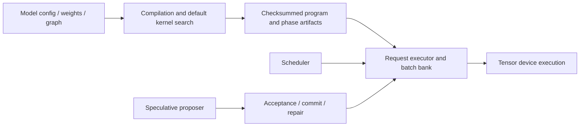

# Inference architecture

A model declares configuration, checkpoint storage and an operation graph. The
compiler qualifies kernels and writes a program. The executor consumes that
program, owns request slots and dispatches its compiled phase geometries. Tensor
supplies compilation, device buffers, launches and capture.

## Reading map

| Area | Entry point | Responsibility |
| --- | --- | --- |
| Models | `models/<family>/model.py` | Compose operations and declare request bindings |
| Graph | `graph.py` | Buffers, views, ordered calls and ownership roles |
| Operations | `ops/<operation>/operation.py` | Eligibility, schedules, references and composition |
| Quantization | `quantization/weights/`, `activations/`, `kv/` | Storage, codecs and format-specific primitives |
| Compilation | `compilation/compile.py` | Qualify and emit all phases through one coordinator |
| Artifacts | `artifacts/schema.py`, `read.py`, `write.py` | Descriptors, integrity and publication |
| Execution | `execution/executor.py` | Request lifecycle, forward dispatch and verification |
| Generation | `generation/speculative/decoding.py` | Proposer-independent speculative flow |
| Scheduling | `scheduling/` | Queues, admission and token budgets |
| Serving | `serving/` | HTTP transport around a caller-supplied Engine |
| Text | `text/tokenizer.py` | Shared tokenization with serialized format rules |
| Benchmarks | `benchmarking/` | Reproducible timing, accounting and regression reports |

## Ownership and phases

Weights and persistent state are shared across compiled geometries. A request slot
identifies state, independently of its current execution row. Semantic bindings
identify tokens, mappings, positions, lengths and predictions; the executor does
not infer model names from buffer names.

Scratch lifetimes follow graph calls, including borrowed views. Scratch can share
an allocation only when lifetimes do not overlap. Views borrow storage and retain
independent descriptors. Verification journals remain live until accepted-prefix
commit or discard. Admission/release reset model-declared state; stale KV beyond
the current position remains unread.

Prefill, decode, verification and proposal are separate phases. This preserves
their different algorithms, chunk layouts and state effects. A batch bank selects
the smallest qualified row capacity for the requested phase/chunk. It does not
force every request group into the largest launch.

MTP is one proposal head in `models/heads/mtp.py`. The shared coordinator performs
proposal, verification, acceptance, commit and repair. `execution/replay.py` can
capture the whole round. `execution/state.py` owns deferred recurrent journals.
Future heads implement the same proposer protocol.

## Compilation and tuning

Kernel beam search is on by default. Operations supply implementation choices,
schedule axes and independent references. AKAS checks numerical results, state,
immutable inputs and every call's storage ABI, then invokes Tensor's search and
measurement. Compilation records the selected target/geometry and qualification.
A result qualifies its measured workloads; it does not prove universal peak speed.

Each build owns separate phase/kernel paths. The program index is published after
its artifacts. Failed replacements leave the previous index and artifacts intact.
Installed inference imports do not require the compiler or reference frameworks.
See [compilation](../src/akas/compilation/README.md) and
[execution](../src/akas/execution/README.md) for file responsibilities.

## Qualification

Dense Qwen, MoE Qwen and LFM public constructors share one Executor and program
compiler. Legacy execution bindings, independent adapters, numerical recipes,
factories and transforms have been removed. Operation-owned policies preserve
optimized physical pipelines; beam search qualifies their registered kernel axes.
Geometry remains explicit, and pipeline choices remain explicit policies.

Local qualification covers CPU contracts and targeted CUDA/WebGPU correctness,
request isolation, packed storage, KV codecs, speculative rounds and recomputation.
State-only prefill preserves persistent state while removing terminal output work.
Hopper execution and full-model performance parity across every batch/context have
not been verified on this L40S instance. Long-context LFM FP8 trajectory drift is
still unresolved.
