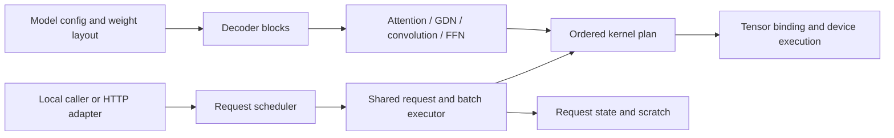

# Engine architecture

Model definitions supply architecture, weight mappings and numerical constraints.
Shared operations compose their forward paths. Shared executors own resident
resources, request state, execution batches and graph lifetimes. Tensor supplies
compilation, buffers, artifact execution and device graphs.

## Models and operations

`models/lfm2/` and `models/qwen35/` each contain `config.py`, `weights.py` and
`model.py`. Dense and MoE Qwen are variants of one family. The definitions compose
`DecoderBlock` objects with explicit mixer, feed-forward and weight roles. See
[the model reading map](../src/akas/models/README.md).

`models/blocks.py` contains the shared decoder declarations. Each operation in
`ops/` owns its `compose.py` and its numerical kernels: attention, GDN, convolution,
linear, normalization, FFN and MoE. Supporting vocabulary, sequence, quantization
and reduction operations have the same ownership. CUDA and WebGPU variants exist
only where implemented. [The operation map](../src/akas/ops/README.md) gives the
reading path.

`execution/executor.py` owns the common request-slot lifecycle, batch validation,
prefill and decode interface, owner-thread checks and resource teardown. Every
scheduled forward uses persistent slot IDs; numerical bindings choose how those
slots map to kernel rows.

`execution/bindings/` contains packed-weight, block-FP8 and BF16 buffer bindings.
Packed handles execute selected sequences serially; block-FP8 kernels retain
fixed row IDs and mask inactive rows; BF16 kernels map selected slots into dense
execution rows. These are kernel layout constraints underneath one executor,
not separate request engines. Precision, rounding and compiled geometry remain
explicit. Existing direct LFM2 request handles and Qwen forward helpers remain
available for benchmarks and compatibility.

Bindings own their kernel requirements and workspace layouts. Operation schedules
live in `ops/schedules/` and `ops/linear/schedule.py`; compiler-only factory routing
lives in `compilation/factories/`. `execution/plan.py` resolves kernels and binds
ordered calls, while `tensor/executor.py` submits or captures them using Tensor.

## Ownership

| Owner | Resources | Lifetime |
| --- | --- | --- |
| Caller | Tensor device | Encloses engine lifetime |
| Resident executor | Weights and loaded kernels | Shared across requests |
| Request | Position, KV/convolution/GDN state | Admission through release |
| Execution geometry | Scratch, bound calls and captured graphs | Geometry/profile |
| Scheduler | Queues, admission and work budgets | Engine lifetime |
| Transport | Connections, events and cancellation signals | Client connection |

Plans borrow resources. Request slots remain distinct from execution row IDs.
The common executor owns occupied slots, positions and pending verification.
Each binding supplies state reset, release cleanup and forward hooks; the handle
binding adapts any `IndependentModel`, without loading checkpoints or selecting
provider kernels. Model factories supply checkpoint and architecture definitions.
Submission and cancellation use thread-safe queues/signals; execution and resource
destruction stay on the owner thread.

`memory/state.py` allocates explicit buffer specifications and releases partial
allocations on failure. `memory/layouts.py` derives buffer specifications from geometry; both allocation
and byte estimates use these specifications, including FP8 KV scales.
`execution/bindings/bf16/journal.py` owns deferred recurrent execution. Speculative
verification commits or restores state at the accepted prefix for each request.

`checkpoints/` implements GGUF/safetensors reading and bit-preserving transfer.
Models declare inventories and projection packing layouts; upload implementations
own transfer barriers and allocation cleanup. `artifacts/` implements kernel
coverage, integrity, loading and implementation identities.

`generation/` owns prompt/termination policy, acceptance and output lookup.
Provider submission lives in `execution/bindings/packed/greedy.py`; MTP orchestration
lives in the numerical bindings' `speculative.py`, alongside commit and repair. The retained
paths have different commit semantics, represented explicitly. `serving/` handles
transport over any `Engine`. Caller-owned factories provide devices, model adapters,
tokenizers and metadata; LFM2 and Qwen dense examples use the same HTTP routes.
`text/tokenizer.py` supplies one byte-level BPE implementation to both families.
`text/formats.py` loads GGUF or local tokenizer JSON rules; `text/chat.py` owns
bounded ChatML formatting independently of tokenization.
The fixed-slot MoE benchmark server retains
its experimental lifecycle and qualification limits.

## Extension and qualification

Add a model by declaring its configuration, checkpoint layout and decoder blocks.
Reuse the common executor and select compatible numerical bindings.
Add an operation/profile variant when those numerical contracts differ. A model
should not implement its own device launch loop or graph-resource lifecycle.

Paged caches need continuation semantics for both KV and recurrent state. Token
beam search requires state fork/reorder. The scheduled API currently supports
greedy token-ID generation bounded by output length; LFM2's convenience generator
also provides tokenizer/chat formatting and EOS stopping.

AKAS depends on a pinned published Tensor revision. Consumers need no compiler or
reference framework. Existing whole-model Qwen qualification limits remain; CPU
plan parity and local CUDA checks do not qualify Hopper or WebGPU profiles.

## Offline compilation

`compilation/build.py` handles source reuse, CUDA/WGSL builds and atomic manifests.
Compilation recipes accept loaded checkpoints and declare kernel specializations;
models do not supply custom producers. Recipes select geometry
and produce artifacts for the corresponding execution contracts. See
[the compilation map](../src/akas/compilation/README.md). Kernel and serving searches live in
`benchmarks/`; general setup lives in `tools/`, and model-specific downloads live with benchmarks. Producer dependencies do not
enter installed runtime imports.

Bundles fingerprint model definitions, shared operations, execution, transfer and
memory code. Rebuild implementation-bound bundles after changes. Historical
reports and frozen source identities remain unchanged.

## Compiled runtime direction

The merged executor preserves the existing numerical implementations and
shape-specialized bundles. It does not yet remove compilation by batch/chunk
geometry or introduce adaptive runtime dispatch.

The next execution contract should consume one bundle per model, precision and
GPU target, containing a small set of dynamic kernel variants. Live token rows,
sequence lengths and request mappings select precompiled variants; allocation
capacity and graph capture are separate from kernel compilation. Offline tuning
must score mixed workloads and test dispatch boundaries, including large-batch
throughput regressions. The runtime should bind plans once, update metadata in
bulk, and submit or replay GPU work without loading compilation or tuning code.
A native executor is justified by measured CPU overhead, rather than required by
the directory structure.
